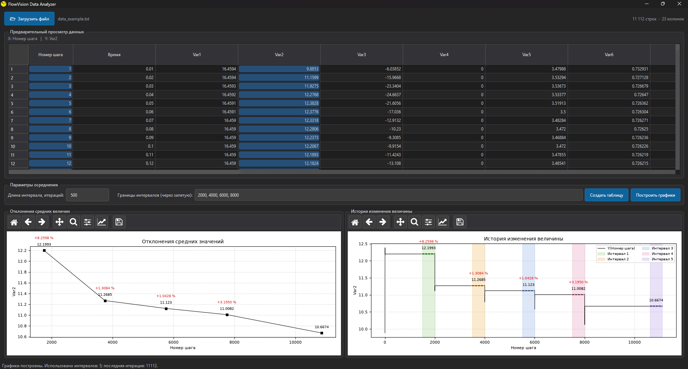
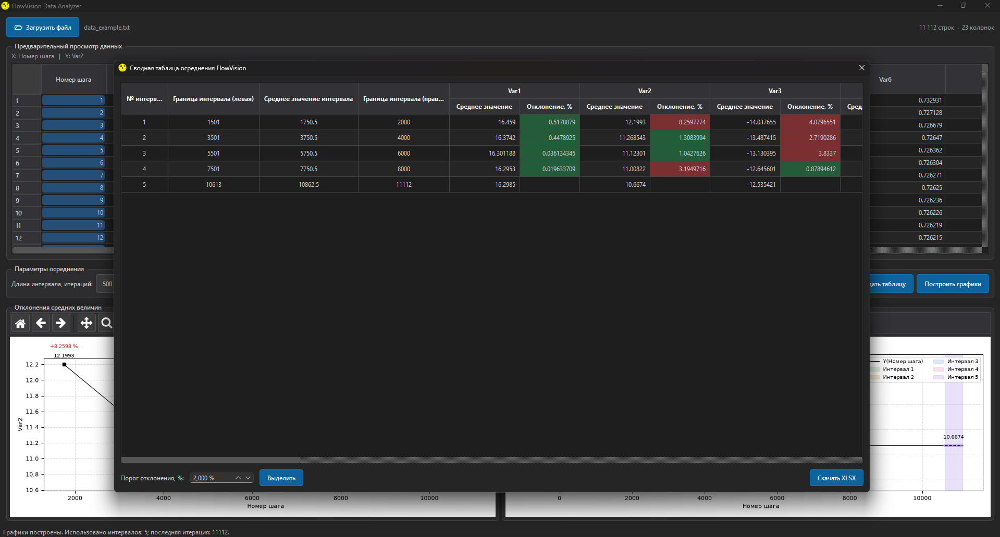

# FlowVision Data Analyzer

Приложение для обработки, анализа и визуализации результатов численного моделирования и экспериментальных исследований, представленных в виде текстовых таблиц (`.txt`).

**Программа применима не только к FlowVision**. Поддерживает данные из других источников при условии соответствия входного файла установленному формату.

  

<i>Рисуно1 - Интерфейс главного окна приложения</i>

  

<i>Рисунок 2 - Интерфейс окна осредненных величин по указанным интервалам</i>

## Возможности

- Загрузка и просмотр TXT-таблиц.
- Обработка и анализ данных.
- Построение графиков.
- Анализ интервалов осреднения.
- Экспорт результатов в Excel (`.xlsx`).

## Использование

1. Запустите `FlowVision_DataAnalyzer.exe`.
2. Загрузите TXT-файл с исходными данными.
3. Выполните обработку и анализ.
4. При необходимости экспортируйте результаты в Excel.

Пример входного файла: `data_example.txt`.
